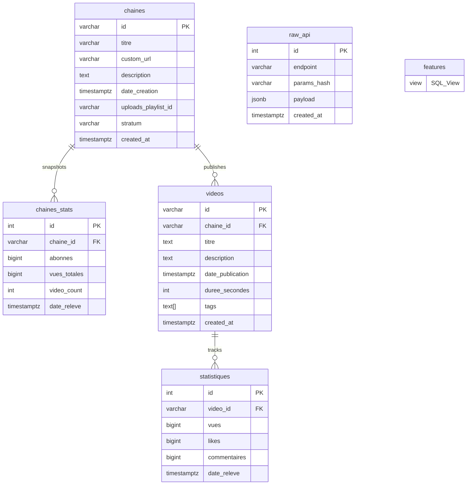
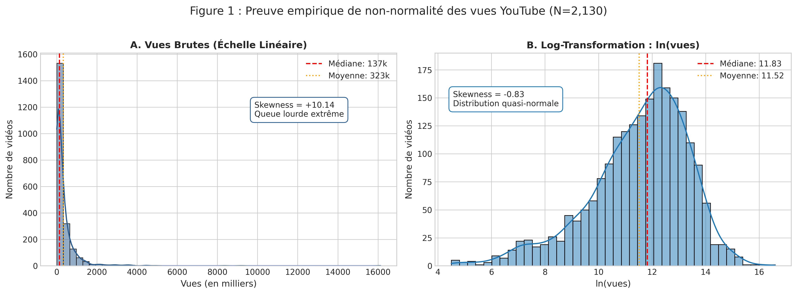
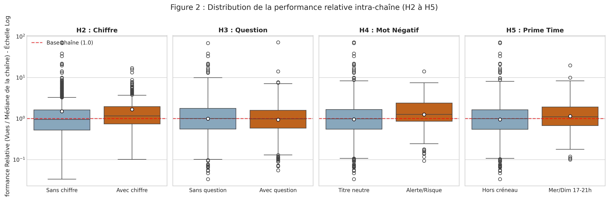
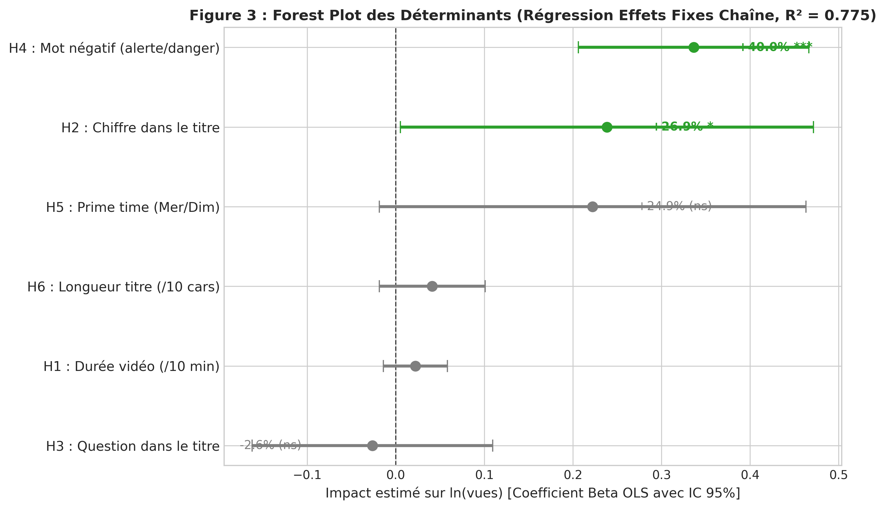
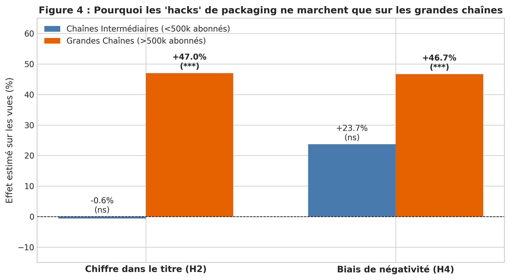

# Determinants of Video Performance in French Science Popularization on YouTube (2024–2025)

[](https://www.python.org/)
[](https://neon.tech/)
[](LICENSE)

An econometric and data engineering portfolio study investigating the structural and textual determinants associated with relative YouTube video performance within the French science and educational popularization niche (*Vulgarisation scientifique*).

---

## Executive Summary

- **Sample**: **2,130 mature long-form videos** (>60s) from **43 active channels** published between **January 1, 2024, and December 31, 2025** (older than 30 days to avoid recency decay).
- **Core Findings**:
  1. **Negativity Bias (H4 - Confirmed)**: Titles containing hazard/error lexemes (*erreur, danger, pire, faux, menace*) are associated with a **+40.0% boost in views** ($p < 0.0001$) within a creator's catalog.
  2. **Quantified Titles (H2 - Confirmed)**: Digits in titles correlate with a **+26.9% boost** ($p = 0.045$).
  3. **The Curiosity Gap Myth (H3 - Refuted)**: Phrasing titles as questions (*"Pourquoi...", "Comment..."*) has **zero statistically significant association** with view gains ($-2.6\%$, $p = 0.70$).
  4. **Duration Confound (H1 - Refuted)**: While univariate Spearman correlation suggests longer videos perform better ($\rho = +0.31$, $p < 10^{-46}$), this is entirely an **omitted-variable artifact of channel size**. Under channel fixed effects, duration has **no statistically significant effect** ($+0.2\%$ per minute, $p = 0.23$).
  5. **Stratum Asymmetry**: Title optimization heuristics (numbers, negative lexemes) provide massive leverage (+47%) for large channels (>500k subscribers), but have **zero to negligible impact on mid/small channels (<500k)**.

---

## Relational Database Architecture

The raw JSON from Google YouTube Data API v3 is ingested into **Neon PostgreSQL** using a normalized relational schema with full historical audit logging (`raw_api`).



Feature extraction and metric standardization are performed directly in-database via the `features` view:
- **Baseline Normalization**: Median views per channel calculated via `PERCENTILE_CONT(0.5)` inside a CTE.
- **Relative Performance ($V_{\text{rel}}$)**: $\frac{\text{views}_{ic}}{\text{median}(\text{views})_c}$.
- **Textual Regex Mining**: POSIX word boundary regexes (`\y...\y`) for interrogatives and hazard lexemes.
- **Temporal Alignment**: Extraction of publication day and hour adjusted to `Europe/Paris` timezone.

---

## Pre-Registered Hypotheses & Econometric Results

All hypotheses were pre-registered before examining statistical outcomes. Estimation is conducted via **Ordinary Least Squares (OLS) with Channel Fixed Effects ($\alpha_c$)** and **Cluster-Robust Standard Errors** at the channel level ($R^2 = 0.775$):

$$\ln(\text{vues}_{ic}) = \alpha_c + \beta_1 \cdot \text{duree}_{ic} + \beta_2 \cdot \text{chiffre}_{ic} + \beta_3 \cdot \text{question}_{ic} + \beta_4 \cdot \text{negatif}_{ic} + \beta_5 \cdot \text{primetime}_{ic} + \beta_6 \cdot \text{longueur}_{ic} + \beta_7 \cdot \text{age}_{ic} + \epsilon_{ic}$$

| Hypothesis | Feature | Predicted Direction | Univariate Non-Parametric | Multivariate OLS FE ($\beta$) | Estimated Views Impact | p-value (Clustered) | Final Verdict |
|---|---|---|---|---|---|---|---|
| **H1** | Video Duration | Positive up to plateau | $\rho = +0.308$ ($p < 10^{-46}$) | $\beta = +0.0022$ | $+0.2\%$ / min | $p = 0.2300$ | **REFUTED** (Confounded by channel size) |
| **H2** | Number in Title | Positive | $\delta = +0.155$ ($p < 10^{-6}$) | $\beta = +0.2385$ | **$+26.9\%$** | $p = 0.0450$ (*) | **CONFIRMED** |
| **H3** | Question in Title | Positive | $\delta = -0.032$ ($p = 0.23$) | $\beta = -0.0262$ | $-2.6\%$ | $p = 0.7048$ | **REFUTED** (No curiosity gap effect) |
| **H4** | Negativity Bias | Positive | $\delta = +0.191$ ($p < 10^{-3}$) | $\beta = +0.3363$ | **$+40.0\%$** | $p < 0.0001$ (***) | **CONFIRMED** (Strongest content lever) |
| **H5** | Prime Publishing Time | Positive | $\delta = +0.105$ ($p = 0.003$) | $\beta = +0.2223$ | $+24.9\%$ | $p = 0.0703$ | **INCONCLUSIVE** ($p > 0.05$) |
| **H6** | Title Length | Inverted-U | $\rho = +0.094$ ($p < 10^{-4}$) | $\beta = +0.0041$ | $+0.4\%$ / char | $p = 0.1760$ | **REFUTED** (Practically negligible) |

---

## Visualizations

### 1. Proof of Log-Normal View Distribution

*Raw views exhibit extreme right-skewness (Skewness = +10.14, D'Agostino-Pearson $p < 10^{-15}$), strictly violating Gaussian assumptions and invalidating Student's t-tests. Log-transform achieves near-symmetry (Skewness = -0.83).*

### 2. Relative Performance Boxplots (Log Scale)

*Distribution of relative performance ($V_{\text{rel}}$) across binary features. The red dashed line represents the creator's historical median ($1.0$).*

### 3. Econometric Forest Plot (OLS Fixed Effects)

*Point estimates ($\beta$) with 95% confidence intervals. Only negative words (+40.0%) and numbers (+26.9%) remain statistically significant after controlling for channel fixed effects.*

### 4. Stratum Heterogeneity (<500k vs >500k)

*Title packaging heuristics drive substantial engagement on large broadcast channels (+47%) competing for broad recommendation feeds, but provide zero leverage on mid/small channels.*

---

## Robustness Checks

1. **Shorts Leakage Test**: Mixing YouTube Shorts ($\le 60\text{s}$) into the sample artificially changes the duration coefficient from non-significant ($p = 0.230$) to statistically significant ($p = 0.047$), and dilutes textual signals. Strict separation is mathematically validated.
2. **Multiple Testing Correction**: Applying Benjamini-Hochberg (FDR) on univariate $p$-values confirms that H2, H4, and H1 remain robust under family-wise error control.

---

## Methodological Limitations

In compliance with empirical standards:
1. **Association vs. Causation**: Regression measures observational correlation. Negative wording may be attached to topics with higher inherent public salience.
2. **Unobservable Platform Signals**: YouTube's public API does not expose thumbnail click-through rates (CTR) or average percentage viewed (retention curves), which are primary recommendation weights.
3. **Lexical Regex Simplicity**: Dictionary matching with POSIX boundaries is a crude proxy compared to transformer-based NLP semantic sentiment analysis.
4. **Survivorship Bias**: Snowball sampling of active peer-recommended creators excludes channels that ceased publishing during the 2024–2025 window.

---

## Repository Structure

```text
├── assets/                  # High-resolution (300 DPI) publication figures
├── data/                    # Seed CSV of stratified channel handles
├── notebooks/               # Executed Jupyter notebook (analysis.ipynb)
├── sql/
│   ├── schema.sql           # PostgreSQL DDL with indexes and constraints
│   └── features.sql         # Analytical SQL view (median CTE + regex mining)
├── src/
│   ├── config.py            # Environment validation (fail-fast)
│   ├── resolve_channels.py  # Channel metadata extraction & stratification
│   ├── extract_videos.py    # Batch API extraction with exponential backoff
│   ├── stats_analysis.py    # Non-parametric tests & fixed-effects OLS
│   ├── robustness_checks.py # Shorts leakage and subgroup regressions
│   └── generate_charts.py   # Matplotlib / Seaborn visualization generator
├── PROJECT_STATUS.md        # Running research log & phase checklist
└── requirements.txt         # Pinned Python dependencies
```

---

## Reproduction Guide

```bash
# 1. Clone repository
git clone https://github.com/your-username/youtube-performance-analysis.git
cd youtube-performance-analysis

# 2. Setup Virtual Environment
python -m venv .venv
source .venv/bin/activate  # On Windows: .\.venv\Scripts\activate
pip install -r requirements.txt

# 3. Environment Variables
cp .env.example .env
# Edit .env with your YOUTUBE_API_KEY and DATABASE_URL

# 4. Deploy Database Schema
python -c "from sqlalchemy import create_engine, text; from src.config import DATABASE_URL; engine = create_engine(DATABASE_URL); conn = engine.connect(); [conn.execute(text(s)) for s in open('sql/schema.sql').read().split(';') if s.strip()]; conn.commit(); conn.close()"

# 5. Execute Pipeline
python -m src.resolve_channels
python -m src.extract_videos
python -c "from sqlalchemy import create_engine, text; from src.config import DATABASE_URL; engine = create_engine(DATABASE_URL); conn = engine.connect(); conn.execute(text(open('sql/features.sql').read())); conn.commit(); conn.close()"

# 6. Run Statistical Analysis & Generate Visualizations
python -m src.stats_analysis
python -m src.robustness_checks
python -m src.generate_charts
```
